# Показ дизайна — 20.10.2026

> **Устарело (23.10).** После этого показа сменились первый экран главной (вариант «Vintara»), «Построить», «Готовые дома» (вместо «ключа» веер фото) и первый экран региона. Снимки в `показ/` старые. Как сайт выглядит сейчас — запусти его, а почему так — смотри [РЕШЕНИЯ.md](РЕШЕНИЯ.md).

Для кого: Илья и Игорь перед согласованием дизайн-макета с клиентом. Здесь: что сделано по референсам Ильи (`../ещереференсы/`), снимки на компьютере и телефоне, вопросы, которые нужно решить до показа клиенту.

**Как посмотреть вживую:** `cd platform` → `npm run dev` → http://horoshiy.localhost:3000. Варианты первого экрана открываются по адресам `/preview/hero-1`, `/preview/hero-2`, `/preview/hero-3`, внизу экрана есть переключатель. Живая главная пока прежняя: выбранный вариант встанет на её место одной правкой.

**Снимки:** папка [показ/](показ/), обновить командой `python tools/designshots.py now`. Состояния формы берутся из последнего запуска `python tools/formtest.py`: он отправляет тестовую заявку и сам её удаляет.

Принципы, которых держались:
- от референсов взяты идеи и приёмы, а не чужие цвета и картинки;
- бренд клиента тот же: тёмно-зелёный, золото, засечки;
- правила «Стиль 19.10»: без декоративных градиентов и свечений, тексты — факты клиента;
- все цифры на экранах живые, из админки (71 дом в посёлках, 3 посёлка в продаже, 12 свободных от 8,8 млн, 12 проектов);
- все картинки — фото и планы самого клиента.

## 1. Первый экран — три варианта (выбор за вами)

| | Компьютер | Телефон |
|---|---|---|
| **Сейчас на сайте** | 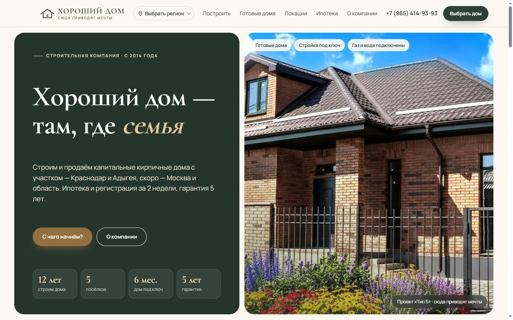 | 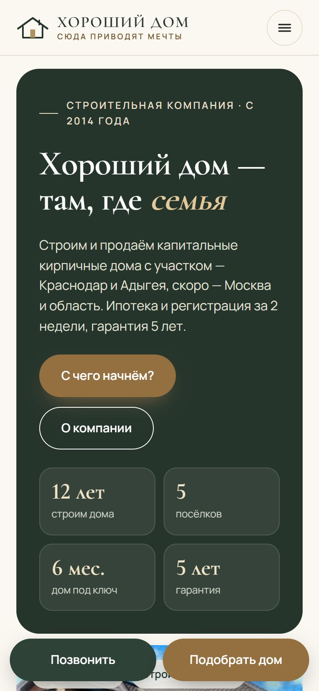 |
| **1 · Дом перед названием** (реф1 Vintara) | 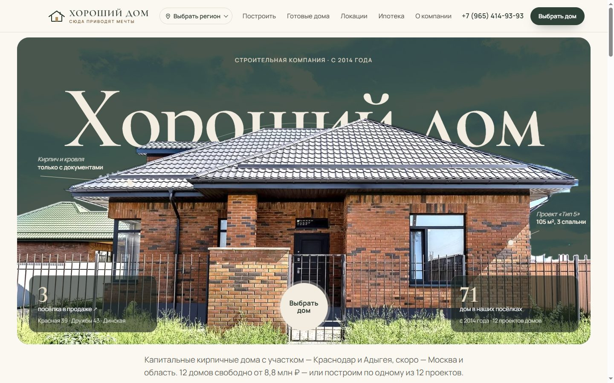 | 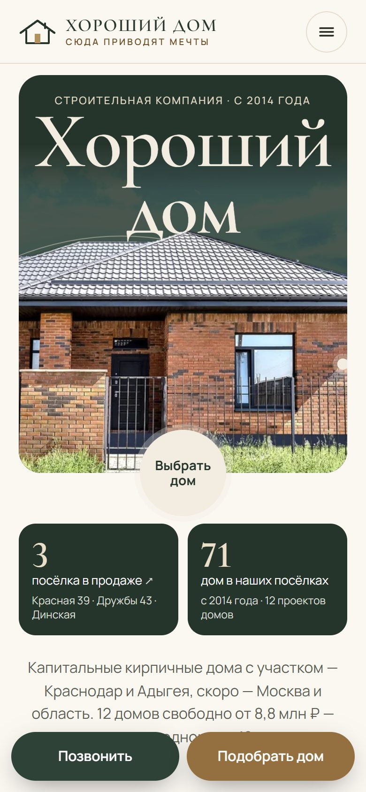 |
| **2 · Через генплан** (реф2 HAVN) | 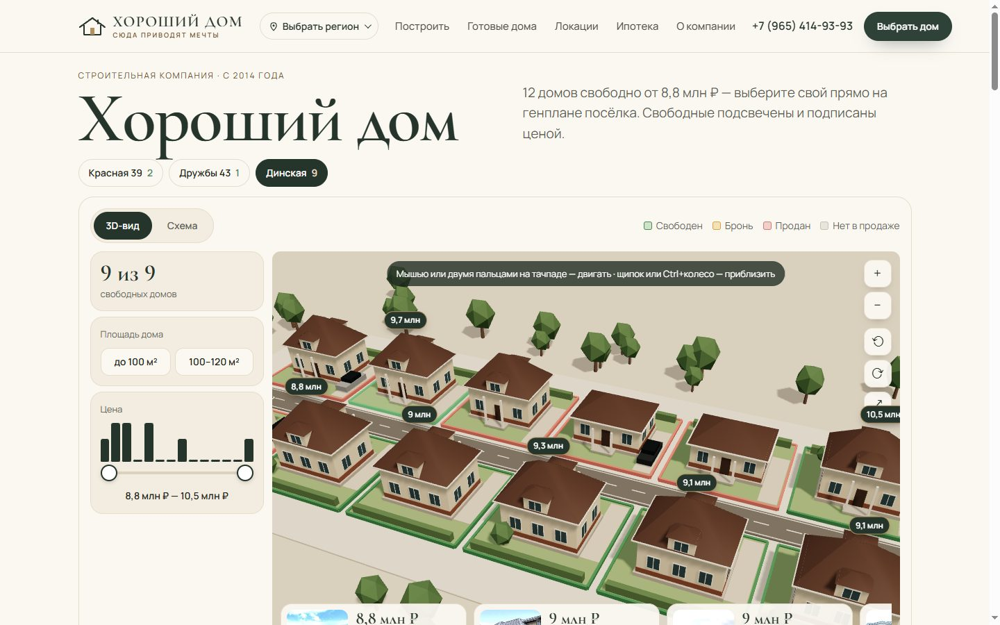 | 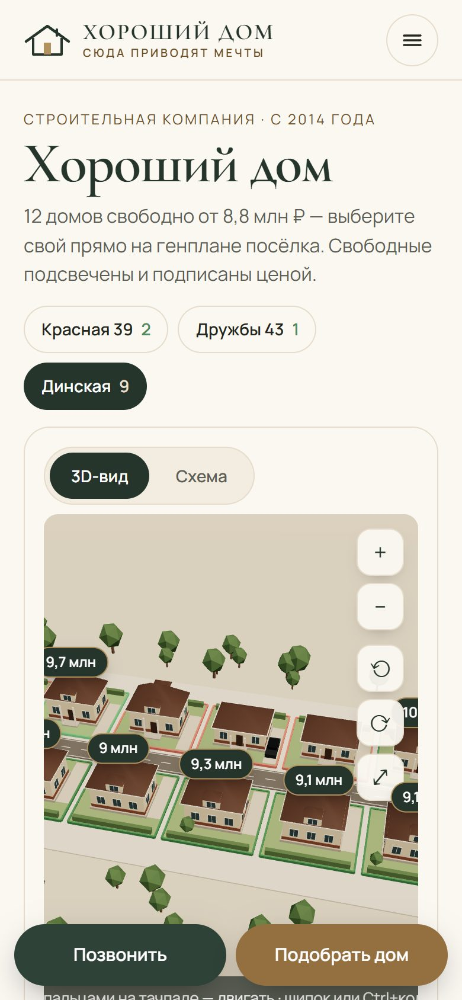 |
| **3 · Минимализм** (реф3 Loom) | 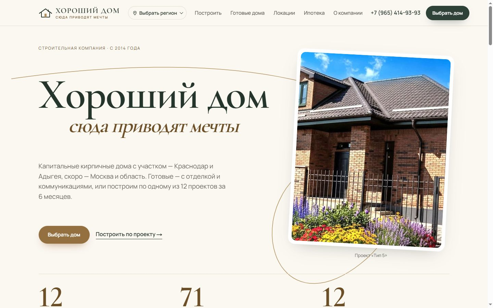 | 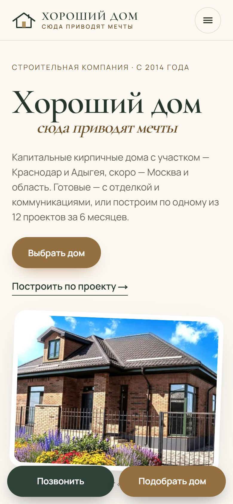 |

- **Вариант 1.** Огромное «Хороший дом», а настоящий дом «Тип 5» стоит перед буквами: крыша закрывает их низ, буквы поднимаются из-за крыши. Небо перекрашено в зелёный бренда. Есть две стеклянные карточки с живыми цифрами, круглая кнопка «Выбрать дом» и тонкие линии к двум точкам на доме («Кирпич и кровля — только с документами», «Проект «Тип 5» — 105 м², 3 спальни»). Небо вырезано скриптом `tools/heroassets.py` из фото клиента.
- **Вариант 2.** Первый экран — сам 3D-генплан посёлка с наибольшим числом свободных домов, с фильтрами и лентой домов, а над ним чипы других посёлков. Ближе всего к покупке, но тяжелее всех: 3D грузится сразу. На телефоне фильтры убраны, первой видна сцена.
- **Вариант 3.** Бумажный фон, название в две строки (вторая — слоган клиента, золотым курсивом), одно наклонённое фото, крупные цифры. Тонкая золотая нить обвивает фото и идёт дальше по странице.

**Рекомендация:** вариант 1 на главную — он самый запоминающийся и при этом на реальном фото. Генплан по варианту 2 и так стоит на страницах посёлков, так что покупатель до него дойдёт.

## 2. Что сделано по каждому референсу

| Референс | Что взяли | Что сделано | Где посмотреть |
|---|---|---|---|
| 1 Vintara | огромное название; дом перед буквами; 2 стеклянные карточки-факта; круглая кнопка; тонкие линии к точкам | вариант 1 первого экрана (см. выше) | `/preview/hero-1`, снимки 02 |
| 2 HAVN | 3D-генплан как главная сцена; цвет статуса; мягкие плитки-фильтры; цена ползунком над гистограммой; лента карточек поверх сцены | **на странице каждого посёлка**: плитки «Площадь / Спальни / Цена» (спальни — только если они различаются), гистограмма цен свободных домов, лента домов поверх сцены. Неподходящие дома сереют прямо в 3D, нажатие на карточку выделяет дом. Плюс вариант 2 первого экрана | `krd.…/objects/dinskaya`, снимки 05, 12; `/preview/hero-2` |
| 3 Loom | нить акцентного цвета через разделы; «Что рядом» — огромные минуты + наклонённые фото; крупные заголовки; полноэкранное меню; мягкие появления | золотая нить по главной: идёт по полям, переходит между разделами и рисуется прокруткой; меню на телефоне — крупные засечки, текущая страница золотым курсивом; вариант 3 первого экрана. Огромные минуты в «Что рядом» и мягкие появления сделаны ещё 19.10 | главная (любой вариант), снимки 04, 14 |
| 4 Skylon | метафора «ключ»: дом в форме дверной таблички с ручкой | на «Готовых домах»: самый дешёвый свободный дом в форме таблички на золотой ручке, рядом факты — «12 домов свободно, от 8,8 млн», «2 недели — ипотека и регистрация», «Ключи — после сделки» | `/catalog`, снимки 10 |
| 5–6 | каркас → дом; чертёж → дом | блок «Проект → Каркас → Дом» на «Построить». План «Тип 5» ложится, из земли поднимается белый набросок, фото «заметает» его с золотой кромкой. Набросок — контуры настоящего фото, геометрия не выдумана. У Нововеличковской тот же блок с честным текстом «Дома ещё нет — есть проекты» и подписью «Пример» | `/build`, Нововеличковская, снимки 07, 08, 13 |
| Живые детали | — | форма: золотая линия заполняется по мере набора телефона, галочка, после отправки рисуется дом и в окне загорается свет. Своя 404 в стиле сайта: дом «только на чертеже» и ссылки с живыми цифрами | снимки 11, 16 |

**Что не сделано и почему:**
- **Наклонённые фото в «Что рядом»** (реф3). Фото мест — школы, парка, магазинов — у клиента нет, а чужие картинки по правилам нельзя. Огромные минуты есть. Вставим, как только клиент пришлёт снимки мест рядом с посёлками.
- **Нить по всем страницам.** Сделана только на главной: на страницах посёлка и дома она спорила бы с генпланом и фотографиями.
- **«Каркас → дом» на 3D-домах.** На «Построить» уже есть 3D-стройка по этапам. Второй 3D-эффект рядом — перебор, поэтому блок сделан на фото и плане.

## 3. Страницы — компьютер и телефон

| Страница | Компьютер | Телефон |
|---|---|---|
| Посёлок «Динская»: генплан как главная сцена | 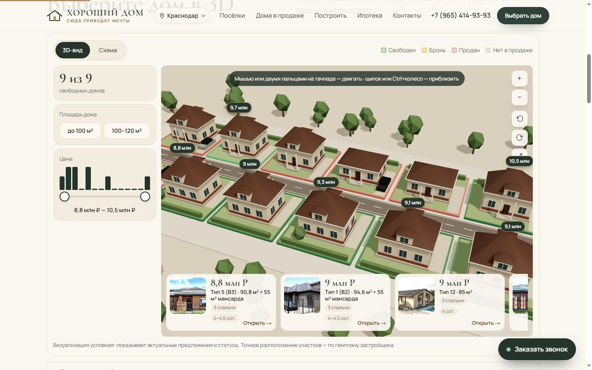 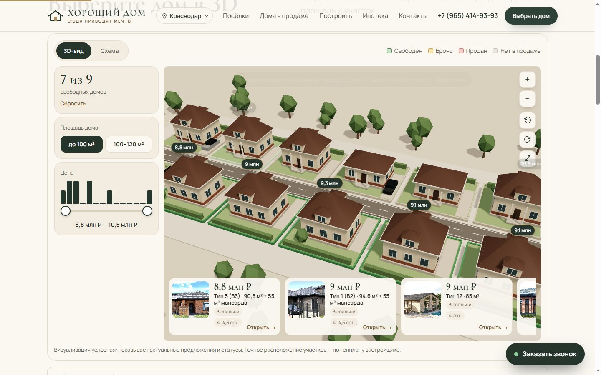 | 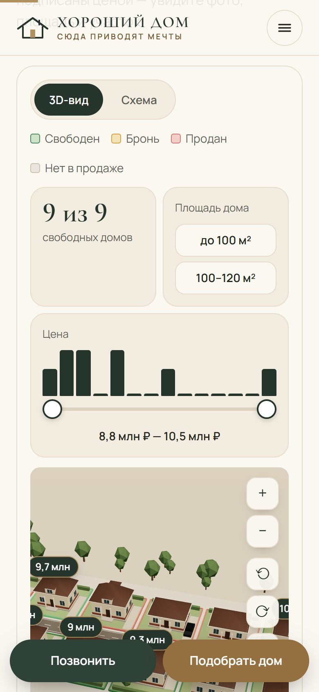 |
| Посёлок целиком | [страница](показ/05-посёлок-динская-d-целиком.jpg) | [страница](показ/05-посёлок-динская-m-целиком.jpg) |
| Дом | 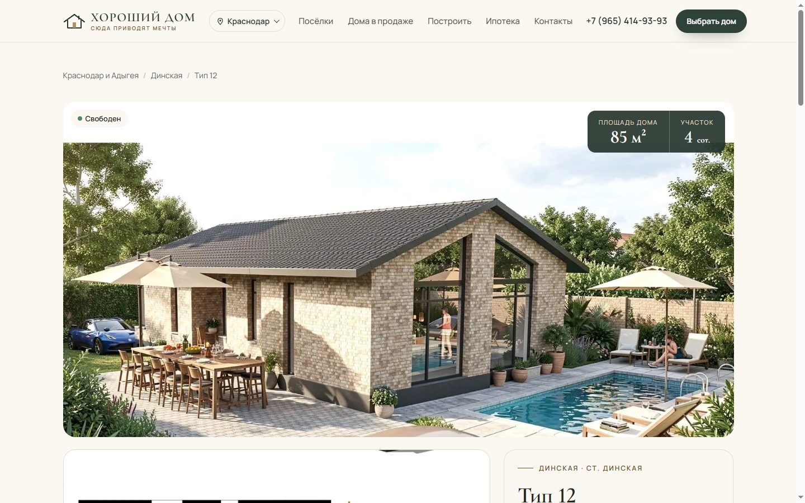 | 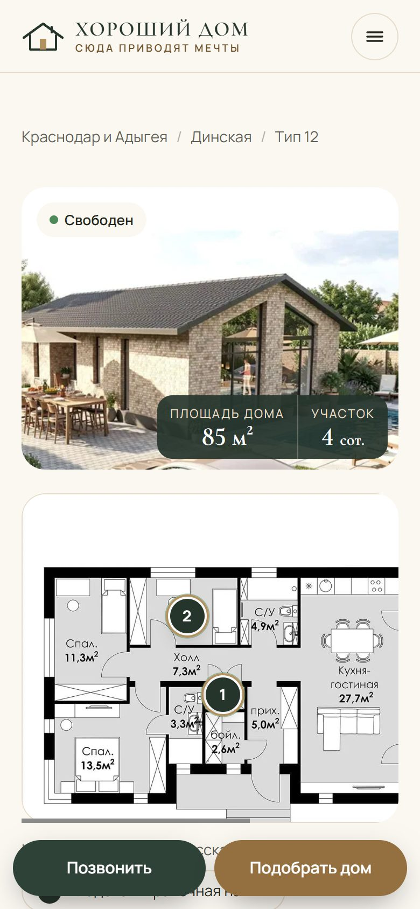 |
| «Построить»: план → каркас → дом | 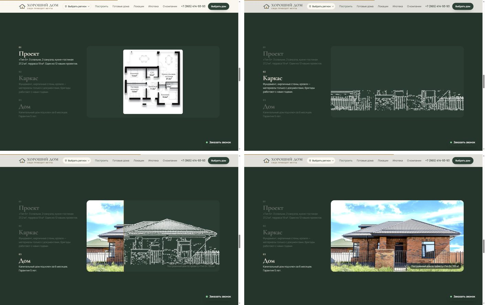 | 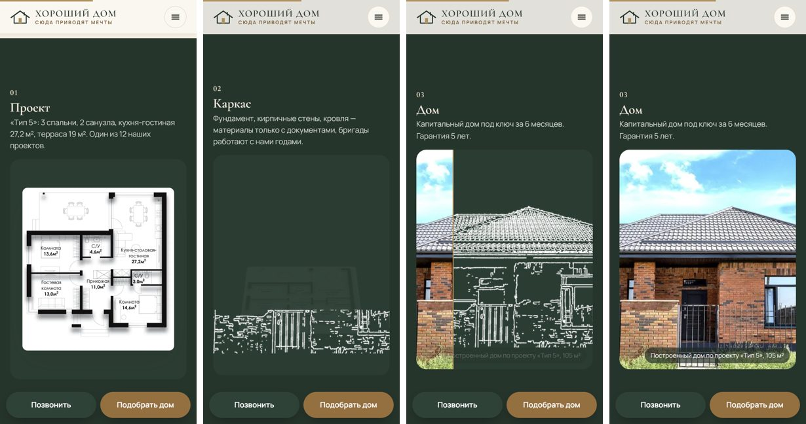 |
| Нововеличковская («скоро») | [страница](показ/08-нововеличковская-скоро-d-целиком.jpg) | [страница](показ/08-нововеличковская-скоро-m-целиком.jpg) |
| Промо-страница района (под рекламу) | 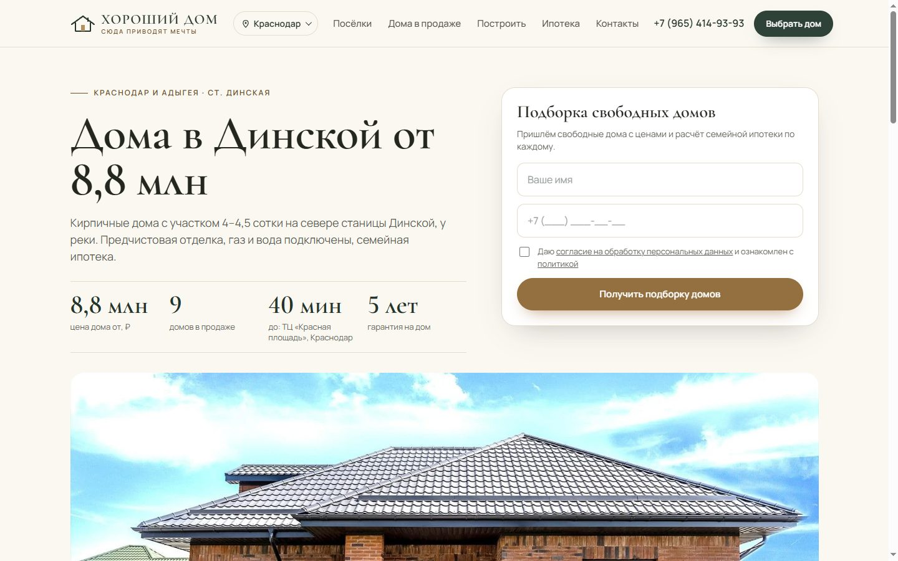 | 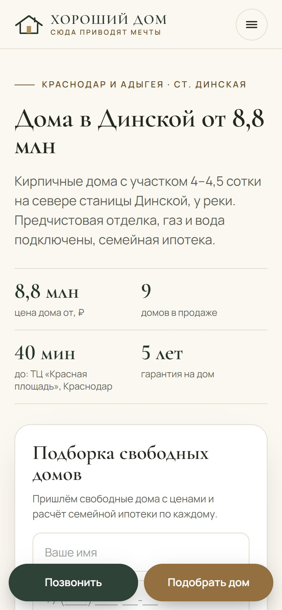 |
| Готовые дома: «ключ» | 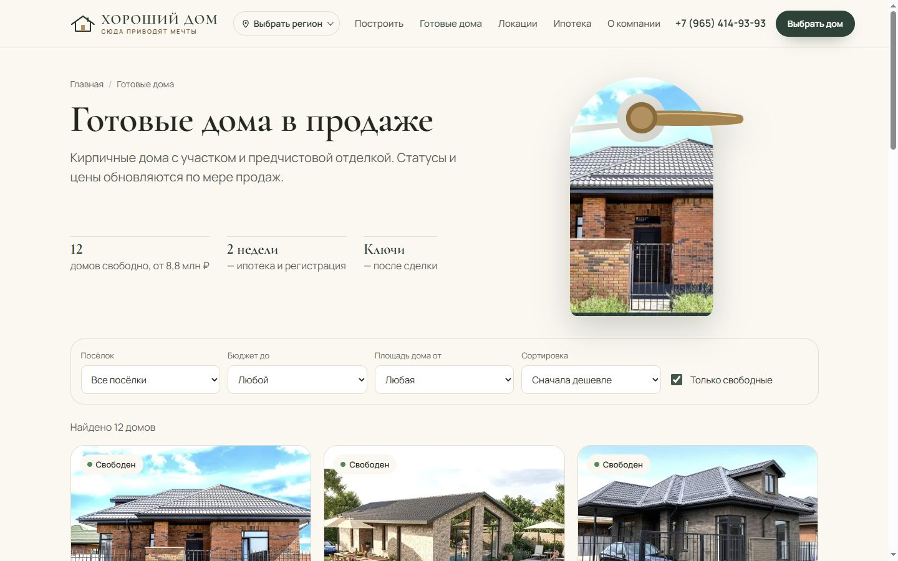 | 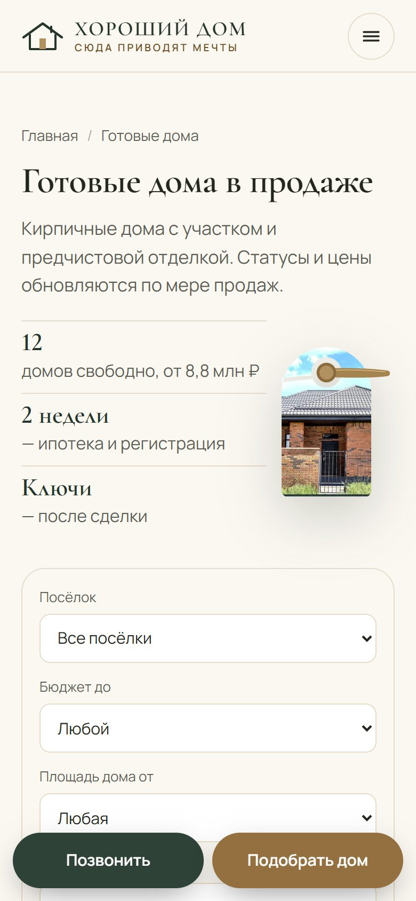 |
| Форма заявки | 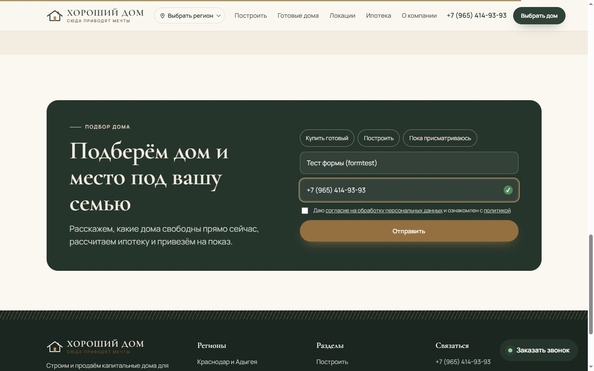 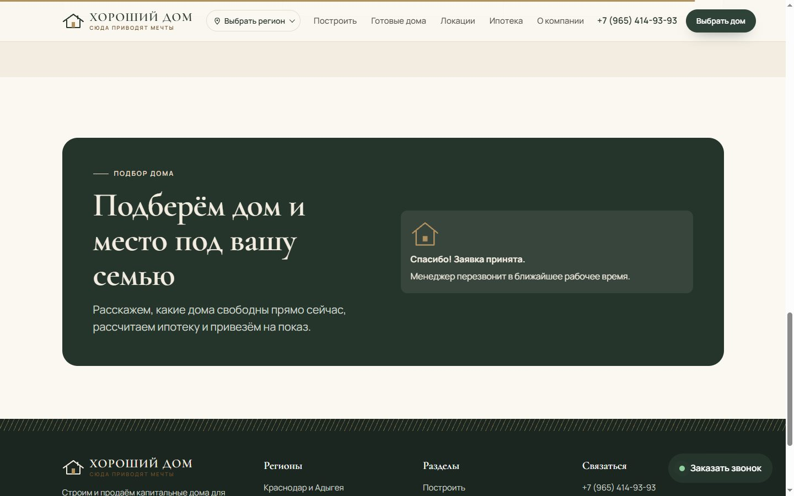 | 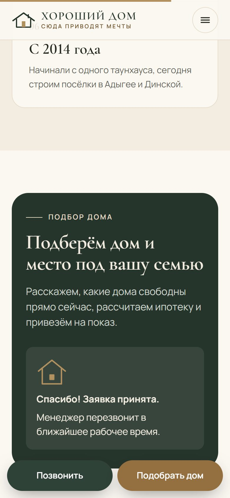 |
| 404 | 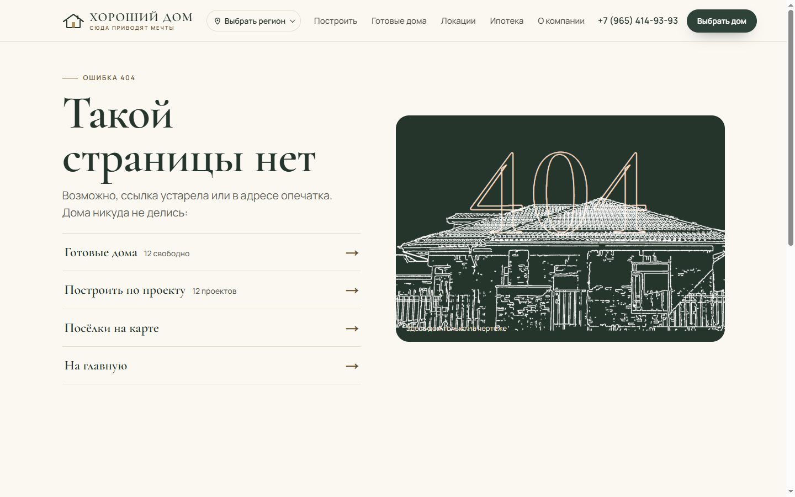 | 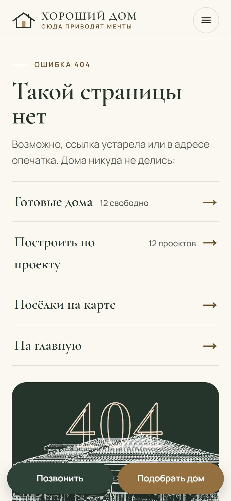 |
| Меню на телефоне | — | 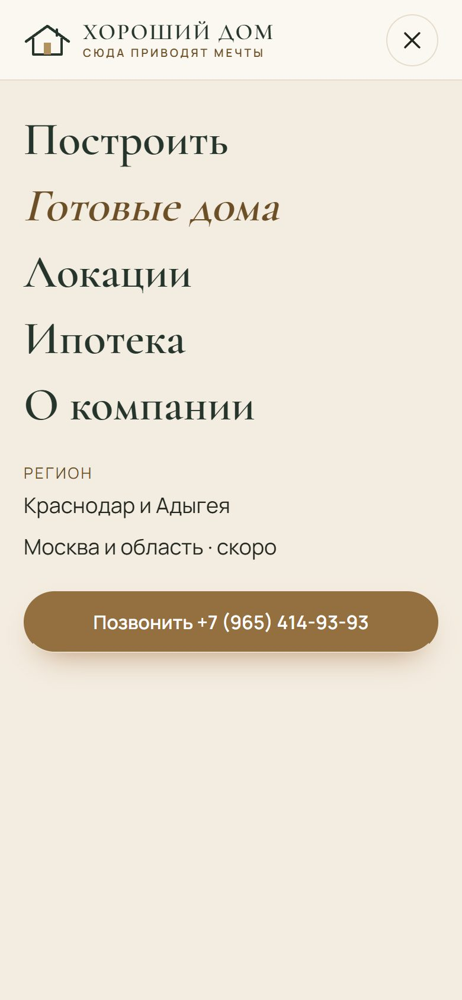 |
| Админка: «Как вести сайт» | 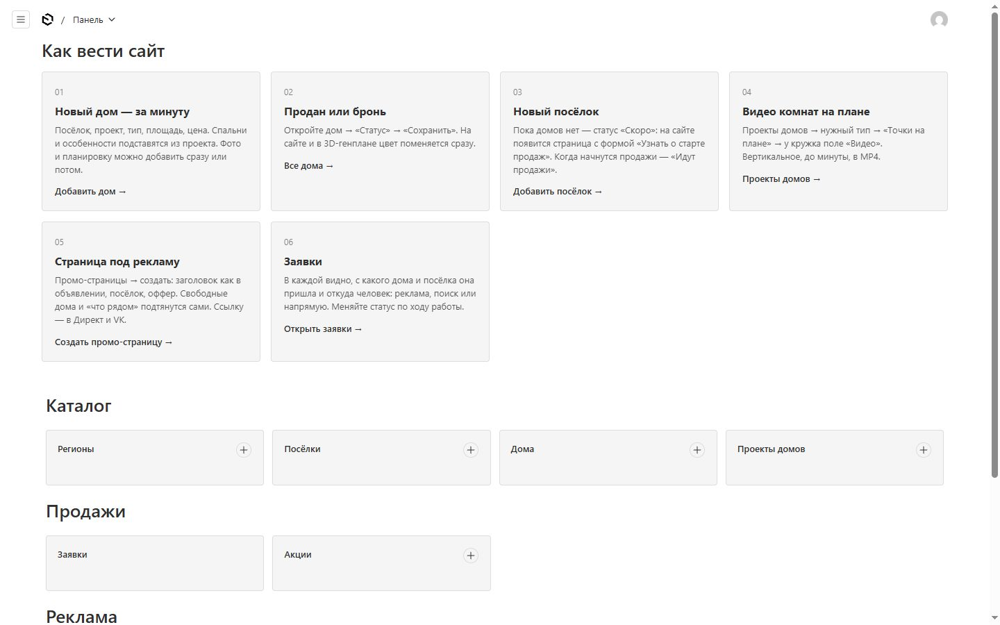 | — |

Все страницы целиком лежат в [показ/](показ/) (`…-целиком.jpg`). Страницы телефона склеены из экранов.

## 4. Что изменилось с прошлого показа (встреча 14.10, видео 15.10)

- **16.10** — админка, которую команда клиента ведёт сама: блок «Как вести сайт», цены в списке, распроданный посёлок закрывает свои дома. Плюс правки под телефон.
- **19.10** — запуск:
  - заявки уходят в amoCRM, при сбое встают в очередь;
  - подключены пиксель VK и Метрика, плашка cookie;
  - промо-страницы районов под рекламу;
  - роли «контент-менеджер» и «РОП»;
  - дизайн-проход по правилам 19.10;
  - лёгкие фото на телефоне.
- **20.10** — всё из раздела 2:
  - три варианта первого экрана;
  - генплан как главная сцена с фильтрами;
  - «план → каркас → дом»;
  - «ключ»;
  - нить по главной;
  - крупное меню;
  - живая форма;
  - своя 404.

  Попутно исправлено:
  - на телефоне кнопка «Позвонить» вылезала за экран;
  - текущая страница в меню нигде не подсвечивалась.

## 5. Вопросы Илье и Игорю

1. **Какой первый экран ставим: 1, 2, 3 или оставить нынешний?** Рекомендация — 1. Можно взять 1 и забрать из 3 нить, она уже есть на главной при любом варианте.
2. **Фото для варианта 1.** Сейчас это «Тип 5» из презентации: картинка 1673 px, небо перекрашено в зелёный бренда. Для показа клиенту лучше попросить оригинал этого кадра или свежий снимок дома с чистым небом, горизонтальный, от 2500 px. Заодно стоит спросить, согласен ли клиент, что небо у главного фото «наше», зелёное.
3. **Проверить у клиента два факта, которые встречаются на экранах:**
   - «Ключи — после сделки»: стоят на «Готовых домах»;
   - «Газ и вода подключены»: стоит в нынешнем первом экране. В материалах клиента написано «возможность подключить газ», это не одно и то же.
4. **Нововеличковская.** Подходит ли подпись «Пример: построенный дом по проекту «Тип 5»» на странице посёлка, где домов ещё нет? Или клиент уже знает, какие проекты будут там?
5. **Нить и круг на варианте 1** — это единственные чисто «ритмические» элементы. Их оставляем или убираем, если клиенту покажется лишним?
